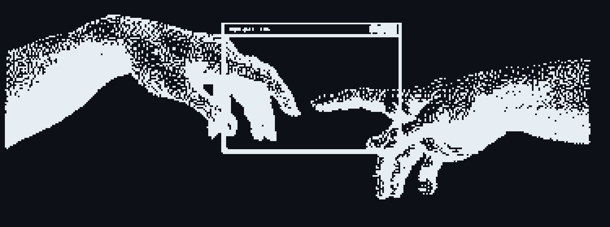

  

  <h1>Hi 👋, I'm Md Ghulam Rabbani</h1>
  
<strong>(Sunny Spiky)</strong>

  <h3>Founder @ Alatix Stack &nbsp;|&nbsp; Full-Stack Engineer</h3>

  

  
<em>Building scalable systems with clean architecture & modern tech.</em>

  

    
  

---

## 🚀 About Me

<table>
  <tr>
    <td width="70%" valign="top">
      

        <strong>Sunny Spiky, Here</strong> — Founder of <strong><a href="https://sunnyspiky.tech/">Alatix Stack</a></strong> and a <strong>Full-Stack Engineer</strong> with <strong>3+ years</strong> of hands-on experience shipping production-grade platforms.
      

      <ul>
        <li>💼 <strong>Full-Lifecycle Engineering:</strong> I build end-to-end systems — from high-throughput backend APIs and robust data architectures to intuitive, performant frontend experiences.</li>
        <li>🏥 <strong>Real-World SaaS:</strong> Currently scaling <strong><a href="https://labsoftix.com/">LabSoftix</a></strong> (Pathology SaaS) and <strong><a href="http://thevisionacademyplus.com/">The Vision Academy Plus</a></strong> (Enterprise LMS) built for heavy operational loads.</li>
        <li>⚡ <strong>Technical Focus:</strong> Advanced System Architecture, practical <strong>Generative AI workflows</strong>, and scalable microservices with <strong>FastAPI</strong> & <strong>Spring Boot</strong>.</li>
      </ul>
      

        🏍️ <strong>Beyond the Terminal:</strong> 
        Long-distance motorcycle road trips & bike maintenance, 3D motion graphics in CapCut, street food discovery, and sci-fi thriller series like <em>Stranger Things</em>.
      

    </td>
    <td width="30%" align="center" valign="middle">
      
    </td>
  </tr>
</table>

---

## 🤝 Connect With Me

  
  &nbsp;&nbsp;
  
  &nbsp;&nbsp;
  
  &nbsp;&nbsp;
  
  &nbsp;&nbsp;
  

    

  
  &nbsp;&nbsp;
  
  &nbsp;&nbsp;
  

---

## 💻 Tech Stack & Toolkit

  
<strong>Languages & Core Frontend</strong>

  

    

  
<strong>Backend Architecture, Databases & DevOps</strong>

  

---

## 🛠️ Featured Projects

<table width="100%">
  <tr>
    <td width="50%" valign="top">
      <h3>🏥 <a href="https://labsoftix.com/">LabSoftix</a></h3>
      
<strong>B2B Pathology Laboratory SaaS Platform</strong>

      
Comprehensive clinical platform powering end-to-end laboratory automation: patient intake, automated report generation, billing, and doctor referral attribution.

      

        
        
        
      

      

        <a href="https://labsoftix.com/" target="_blank"><b>🌐 Visit Live SaaS →</b></a>
      

    </td>
    <td width="50%" valign="top">
      <h3>🎓 <a href="http://thevisionacademyplus.com/">The Vision Academy Plus</a></h3>
      
<strong>Enterprise Learning Management System (LMS)</strong>

      
Engineered for high-volume course delivery, customized role-based portals for students and instructors, and streamlined administrative control.

      

        
        
        
        
      

      

        <a href="http://thevisionacademyplus.com/" target="_blank"><b>🌐 Explore LMS Platform →</b></a>
      

    </td>
  </tr>
  <tr>
    <td width="50%" valign="top">
      <h3>📋 <a href="https://sunnyspiky.tech/tracker/tasks">Alatix Task Tracker</a></h3>
      
<strong>Kanban Productivity Web Application</strong>

      
Fluid productivity tool with drag-and-drop column boards, interactive workflows, and gamified completion animations for elevated user retention.

      

        
        
        
      

      

        <a href="https://sunnyspiky.tech/tracker/tasks" target="_blank"><b>🚀 Launch Web App →</b></a>
      

    </td>
    <td width="50%" valign="top">
      <h3>🐛 GlitchGuard</h3>
      
<strong>Centralized Exception & Error Monitor</strong>

      
Real-time application health monitor capturing runtime exceptions, stack traces, and environment metadata for accelerated developer debugging.

      

        
        
        
      

      

        <code>🔒 Internal Tool @ Alatix Stack</code>
      

    </td>
  </tr>
</table>

---

## 📊 GitHub Analytics

  
    
  
  &nbsp;&nbsp;
  

---

  ⚡ Engineered with passion by <a href="https://sunnyspiky.tech/">Md Ghulam Rabbani (Sunny Spiky)</a> • Founder @ Alatix Stack

